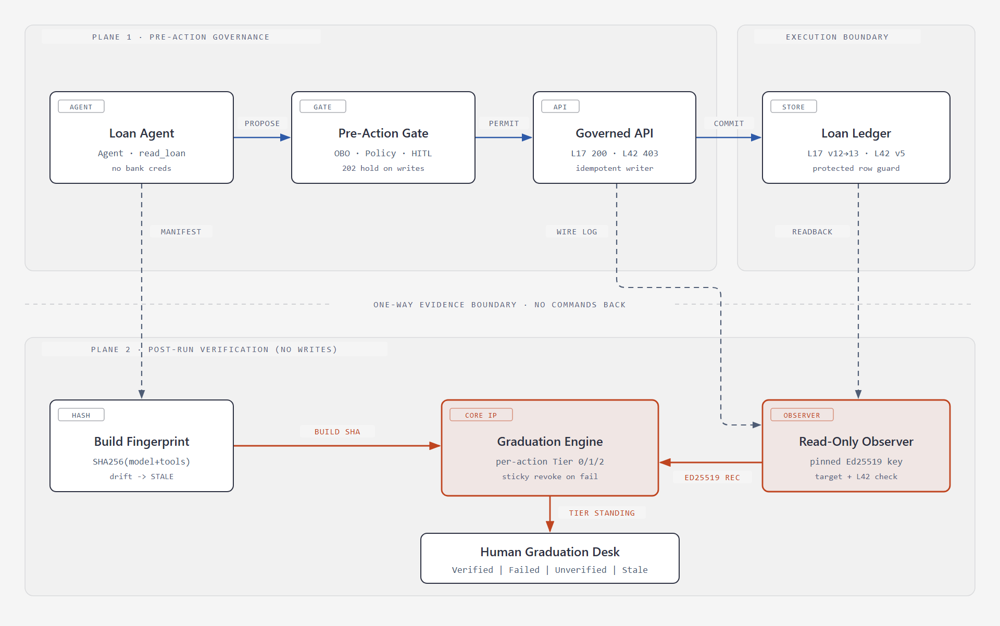

# Earned Autonomy Graduation Engine

A standalone, domain-portable, post-run evidence verification and autonomy-graduation engine for AI agents.

## Why This Exists

Pre-action gateways and policy engines answer **"Was the agent allowed to attempt this action?"**
Earned Autonomy answers the missing post-run question: **"Does independent, out-of-band evidence prove the intended system-of-record change happened and protected non-target state stayed untouched — and should this specific action class earn or lose autonomy?"**

## Architecture



Open the standalone interactive HTML version at [`docs/architecture.html`](docs/architecture.html) (or vector source [`docs/architecture.svg`](docs/architecture.svg)).

## Core Primitives

- **Build Fingerprinting (`fingerprint.py`):** Deterministic `SHA-256(model + instructions + tools + policy)`. Changing a single character in the prompt or adding a tool marks prior `Verified` receipts **`STALE`** and auto-demotes `Tier 2 -> Tier 1`.
- **Pinned Verifier Key Separation (`keys.py`):** The out-of-band observer signs receipts with `observer.key.pem` (Ed25519); the verifier checks strictly against a pinned `verifier.pub.pem`. Receipts signed by rogue or self-supplied keys fail closed.
- **Append-Only Hash-Chained Ledger (`store.py`):** Synchronous JSONL ledger where every entry chains `seq`, `prev_hash`, and `entry_hash`. Any single-byte edit, deletion, or reordering fails closed with exit code `2`.
- **Per-Action-Class Graduation & Sticky Revocation (`graduation.py`):** Each action class (e.g. `read_loan` vs `extend_due_day`) earns its own tier (`Tier 1 -> Tier 2` after `N` consecutive verified+current runs). Passing reads never graduate writes. One protected-state contradiction triggers sticky `Tier 0 (REVOKED / HOLD)` + `global_hold` across all classes until a new remediated build fingerprint and signed `ReinstatementReceipt` are recorded.
- **Portable Domain Contracts (`contracts.py`):** Ships with `contracts/banking-loan.json` and `contracts/it-access.json` to demonstrate domain independence.
- **Offline Graduation Desk & Live Local Demo (`cli.py`, `e2e_runner.py`, `live_desk.py`):** Zero-network single-source-of-truth HTML desk and interactive loopback demo on a disposable SQLite ledger.

## Documentation & Demo Guides

- **Architecture Diagram:** [`docs/architecture.html`](docs/architecture.html) · [`docs/architecture.svg`](docs/architecture.svg) · [`docs/architecture.png`](docs/architecture.png)
- **Operations Runbook:** [`docs/operations-runbook.md`](docs/operations-runbook.md) (onboarding, `STALE` / `Unverified` / `Tier 0 global_hold` response, key rotation)
- **20-Min Pitch & 10-Min Demo Script:** [`docs/pitch-and-demo-script.md`](docs/pitch-and-demo-script.md)

## Quick Start

Requires Python 3.11+ and `cryptography` (`pip install -r requirements.txt`).

```bash
# 1. Run the full 16-test verification suite (engine, D01-D07 E2E, hash-chain & IT portability)
python -B -m unittest -v test_engine test_e2e test_engine_core

# 2. Build the offline single-source Graduation Desk (desk.html)
python -B cli.py --demo-scenarios --build-desk

# 3. Launch the interactive local end-to-end demo (127.0.0.1:8790)
python -B live_desk.py --port 8790 --open
```

### Standalone CLI Engine Workflow

```bash
python -B cli.py init-key --out-dir ./demo-keys
python -B cli.py fingerprint --manifest ./fixtures/sample-agent-manifest.json
python -B cli.py record --key ./demo-keys/observer.key.pem --ledger ./demo.jsonl \
  --action-class read_loan --verdict verified --protected-ok true --has-readback true --build-fp <SHA256>
python -B cli.py verify --pubkey ./demo-keys/verifier.pub.pem --ledger ./demo.jsonl \
  --contract ./contracts/banking-loan.json --active-build-fp <SHA256>
```

## Boundaries & Limits

- **Prototype signing boundary:** Local file-backed Ed25519 keys are used for prototype verification. Production deployments require an out-of-band hardware-backed signer (HSM/KMS).
- **No runtime write authority:** The engine never executes writes or issues runtime credentials; standing is a verifiable governance recommendation for a human release pilot.

## License

MIT
